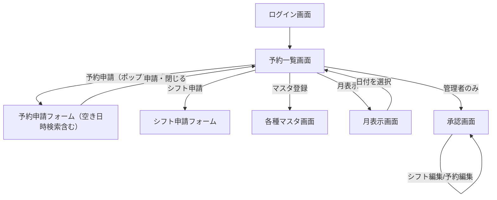

# ヘルプステーション シフト管理・予約管理システム 基本設計書

- 作成日: 2026-09-09
- 前提資料: [要件定義書](./要件定義書.md)（8章46項目中44件解決・2件保留の状態を前提とする）
- ステータス: 一次レビュー反映済み（2026-09-11）

本書は要件定義書で解決済みとなった内容をもとに、画面・データベース・非機能面の設計をまとめたものである。要件定義書8.2（保留・未解決）に残る2件は、本書の該当箇所に「保留」として明記し、確定次第この基本設計書へ反映する。

## 1. システム構成

- クライアント: スマートフォン・タブレットのブラウザ（レスポンシブWebアプリケーション、要件定義書7章参照）
- サーバー: Webアプリケーションサーバー＋データベースサーバーの構成とする
- 通信: HTTPS
- ホスティング環境・冗長構成・バックアップ方式は未確定（要件定義書8.2項目2参照）

## 2. 画面一覧

| # | 画面名 | 対応するロール | 要件定義書 参照 |
|---|---|---|---|
| 1 | ログイン画面 | 全員 | 6.1 |
| 2 | 予約一覧画面（トップ画面） | 全員 | 6.3 |
| 3 | 予約申請フォーム（空き日時検索3パターンを含む。予約一覧画面上のポップアップ） | 職員・管理者 | 6.4.2・6.4.3 |
| 4 | シフト申請フォーム | 職員・管理者 | 6.5.2 |
| 5 | 承認画面（シフト・予約共通） | 管理者のみ | 6.6 |
| 6 | 職員マスタ（一覧／登録・変更・削除、削除は論理削除） | 管理者のみ | 6.8.1 |
| 7 | 利用者マスタ（一覧／登録・変更・削除、削除は論理削除） | 管理者のみ | 6.8.2 |
| 8 | 支援内容マスタ（一覧／登録・変更・削除、削除は論理削除） | 管理者のみ | 6.8.3 |
| 9 | 車両マスタ（一覧／登録・変更・削除、削除は論理削除） | 管理者のみ | 6.8.4 |
| 10 | 月表示画面（予約一覧の月単位表示、閲覧専用） | 全員 | 6.3 |

予約申請フォーム（3）は独立した画面とせず、予約一覧画面（2）の上にポップアップで表示する（8.5参照）。

空き日時検索（3パターン）は独立画面とせず、予約申請フォーム内に検索セクション（タブ等での切替）として組み込み、検索結果を選択するとフォームの日付・時間帯へ自動反映される構成とする。

各マスタ画面（6〜9）には「有効な一覧」と「削除済み一覧」を切り替えるタブ等を設け、削除済み一覧から対象レコードを選んで復元できるようにする（要件定義書8.1項目34参照）。

## 3. 画面遷移

## 4. データベース設計

以下はテーブルの論理設計案である。要件定義書8.1で解決済みとなったDB関連項目（8.1項目13〜16等）を反映している。ER図としての正式化は別途行う。

職員・利用者・支援内容・車両の4マスタは、いずれもシフト・予約等から参照されているため物理削除はせず、論理削除（一覧・選択肢からのみ除外）で統一する（要件定義書8.1項目26参照）。

### 4.1 職員（staff）

| カラム | 型 | 制約 | 備考 |
|---|---|---|---|
| id | INT | PK | |
| login_id | VARCHAR | UNIQUE, NOT NULL | ログイン認証用 |
| password_hash | VARCHAR | NOT NULL | |
| name | VARCHAR | NOT NULL | 氏名 |
| role | ENUM(社員, 管理) | NOT NULL | 3章のロール定義に対応 |
| annual_work_hour_limit | INT | NULL可 | 年間労働時間上限（時間） |
| failed_login_count | INT | NOT NULL | 連続ログイン失敗回数。5回で30分間ロックする（要件定義書8.1項目27参照） |
| last_failed_login_at | DATETIME | NULL可 | 直近のログイン失敗日時。ここから30分経過した失敗はカウントをリセットする |
| locked_until | DATETIME | NULL可 | ロック解除予定時刻。NULLはロックなし |
| deleted_at | DATETIME | NULL可 | 論理削除日時。NULLは有効。削除済みは一覧・選択肢から除外するが、既存シフト・予約からの参照は保持する。削除済み一覧からの復元操作でNULLに戻す |
| created_at | DATETIME | NOT NULL | |
| updated_at | DATETIME | NOT NULL | |

### 4.2 職員デフォルト勤務時間（staff_default_schedule）

曜日ごとに1レコード（職員1人につき7レコード）。

| カラム | 型 | 制約 | 備考 |
|---|---|---|---|
| id | INT | PK | |
| staff_id | INT | FK → staff.id, NOT NULL | |
| day_of_week | TINYINT | 0〜6, NOT NULL | 日〜土 |
| is_am_off | BOOLEAN | NOT NULL | 午前休み（am_off・pm_off両方trueで終日休み） |
| is_pm_off | BOOLEAN | NOT NULL | 午後休み（am_off・pm_off両方trueで終日休み） |
| start_time | TIME | NULL可 | 始業時刻 |
| end_time | TIME | NULL可 | 終業時刻 |

### 4.3 利用者（client）

| カラム | 型 | 制約 | 備考 |
|---|---|---|---|
| id | INT | PK | |
| last_name | VARCHAR | NOT NULL | 苗字のみ（不正アクセス対策） |
| wheelchair_required | BOOLEAN | NOT NULL | 車いすの要否（電動／手動の区別は初回リリースでは行わない、要件定義書9章参照） |
| interval_unit | ENUM(日, 週, 月) | NULL可 | 利用間隔の単位。固定設定がない利用者向けの予約忘れ検出に使用（要件定義書8.1項目4参照） |
| interval_value | INT | NULL可 | 利用間隔の数値。「3」＋「月」で「3か月後」のように、前回予約日からの経過期間を表す |
| fixed_start_date | DATE | NULL可 | 固定（定期訪問）の開始日。終了日は持たず、開始日以降ずっと有効とする（要件定義書8.1項目21参照） |
| deleted_at | DATETIME | NULL可 | 論理削除日時。NULLは有効。削除済みは一覧・選択肢から除外するが、既存シフト・予約からの参照は保持する。削除済み一覧からの復元操作でNULLに戻す |

デフォルト担当者・固定訪問の曜日はいずれも複数選択可のため、以下の中間テーブルで管理する。固定訪問の時刻は曜日ごとに異なりうるため、client_fixed_day_of_week側で保持する。

**利用者デフォルト担当者（client_default_staff）**

複合主キー：(client_id, staff_id)。

| カラム | 型 | 制約 | 備考 |
|---|---|---|---|
| client_id | INT | FK → client.id, NOT NULL | |
| staff_id | INT | FK → staff.id, NOT NULL | 複数登録可。予約申請フォームの担当者初期値として使用 |

**利用者固定訪問曜日（client_fixed_day_of_week）**

複合主キー：(client_id, day_of_week)。

| カラム | 型 | 制約 | 備考 |
|---|---|---|---|
| client_id | INT | FK → client.id, NOT NULL | |
| day_of_week | TINYINT | 0〜6, NOT NULL | 複数登録可。日〜土 |
| fixed_start_time | TIME | NOT NULL | 固定訪問の時刻（開始）。曜日ごとに設定 |
| fixed_end_time | TIME | NOT NULL | 固定訪問の時刻（終了）。曜日ごとに設定 |

### 4.4 支援内容（support_type）

| カラム | 型 | 制約 | 備考 |
|---|---|---|---|
| id | INT | PK | |
| name | VARCHAR | NOT NULL | 通院（病院）等 |
| dispatch_priority | INT | NOT NULL | 配車優先度。管理者が任意に設定・変更可能（要件定義書8.1項目12参照） |
| deleted_at | DATETIME | NULL可 | 論理削除日時。NULLは有効。削除済みは一覧・選択肢から除外するが、既存予約からの参照は保持する。削除済み一覧からの復元操作でNULLに戻す |

### 4.5 車両（vehicle）

| カラム | 型 | 制約 | 備考 |
|---|---|---|---|
| id | INT | PK | |
| name | VARCHAR | NOT NULL | 例：福祉車両1 |
| type | ENUM(福祉車両_電動, 福祉車両_手動, 普通社用車) | NOT NULL | 私用車はレコードを持たない（要件定義書8.1項目7参照）。電動／手動の区別は初回リリースでは業務上行わず、福祉車両は実態によらずすべて「福祉車両_電動」として登録する（要件定義書9章参照） |
| is_unavailable | BOOLEAN | NOT NULL | 使用不可フラグ。点検・故障等で一時的に使用できない状態を示す。trueの間は空き判定の合算台数から除外する（要件定義書8.1項目28参照） |
| deleted_at | DATETIME | NULL可 | 論理削除日時。NULLは有効。削除済みは一覧・選択肢から除外するが、既存シフト・予約からの参照は保持する。削除済み一覧からの復元操作でNULLに戻す |

### 4.6 シフト（shift）／シフト詳細（shift_detail）

shift は職員×対象月で1レコード、shift_detail は日ごとに1レコード。

**shift**

一意制約：(staff_id, target_year_month)の組み合わせは重複しない（職員×対象月で1レコード）。

| カラム | 型 | 制約 | 備考 |
|---|---|---|---|
| id | INT | PK | |
| staff_id | INT | FK → staff.id, NOT NULL | |
| target_year_month | CHAR(7) | NOT NULL | 例：2026-10 |
| submitted_at | DATETIME | NULL可 | 申請日時 |

**shift_detail**

一意制約：(shift_id, date)の組み合わせは重複しない（日ごとに1レコード）。

| カラム | 型 | 制約 | 備考 |
|---|---|---|---|
| id | INT | PK | |
| shift_id | INT | FK → shift.id, NOT NULL | |
| date | DATE | NOT NULL | |
| applied_start_time | TIME | NULL可 | 社員が申請した始業時刻 |
| applied_end_time | TIME | NULL可 | 社員が申請した終業時刻 |
| applied_am_off | BOOLEAN | NOT NULL | 休みの設定（午前休。終日休みはam_off・pm_off両方true） |
| applied_pm_off | BOOLEAN | NOT NULL | 休みの設定（午後休。終日休みはam_off・pm_off両方true） |
| applied_desired_off | BOOLEAN | NOT NULL | 希望休フラグ。休み自体の設定は上記am_off／pm_offで行い、本フラグはその休みが職員本人の希望によるものであることを示す |
| approval_flag | BOOLEAN | NOT NULL | 承認フラグ |
| admin_modified_flag | BOOLEAN | NOT NULL | 管理者が変更したか |
| modified_start_time | TIME | NULL可 | 管理者変更後の始業時刻 |
| modified_end_time | TIME | NULL可 | 管理者変更後の終業時刻 |
| modified_am_off | BOOLEAN | NOT NULL | 管理者変更後の午前休 |
| modified_pm_off | BOOLEAN | NOT NULL | 管理者変更後の午後休 |
| modified_approval_flag | BOOLEAN | NOT NULL | 管理者変更後の承認フラグ |

申請内容と管理者変更内容を別カラムで保持する設計とし、職員が申請した内容自体は保持されたまま、管理者による変更は別データとして記録する。画面上は、管理者変更があれば変更後の内容（確定内容）を表示し、変更があった旨を示す表示を行う。あわせて元の申請内容も参照できるようにする（要件定義書8.1項目11参照）。

### 4.7 予約（reservation）

| カラム | 型 | 制約 | 備考 |
|---|---|---|---|
| id | INT | PK | |
| client_id | INT | FK → client.id, NOT NULL | |
| date | DATE | NOT NULL | |
| start_time | TIME | NOT NULL | 「開始時刻＋終了時刻」方式（要件定義書8.1項目10参照） |
| end_time | TIME | NOT NULL | 「開始時刻＋終了時刻」方式（要件定義書8.1項目10参照） |
| support_type_id | INT | FK → support_type.id, NOT NULL | |
| vehicle_id | INT | FK → vehicle.id, NULL可 | 福祉車両／普通社用車を選択し空きがある場合、配車優先度を参考にシステムが自動的に具体的な1台を決定し即時に設定する。福祉車両・普通社用車は別々の車両プールとして空き判定・優先度判定を行う（要件定義書8.1項目30参照）。後から優先度の高い予約が登録された際、既存予約のvehicle_idがシステムにより自動的に別の車両IDへ更新される場合がある（vehicle_reassigned_flag参照、要件定義書8.1項目31参照）。車不要・私用車の場合は常にNULL（要件定義書6.4.4参照） |
| vehicle_type_choice | ENUM(福祉車両, 普通社用車, 私用車, 車不要) | NOT NULL | フォーム上の選択内容。私用車は車両マスタに存在しないため別カラムで保持 |
| remarks | TEXT | NULL可 | 備考（要件定義書8.1項目14参照） |
| status | ENUM(仮登録, 承認済み) | NOT NULL | 仮登録／承認済みの状態管理用（要件定義書8.1項目15参照）。職員が登録した予約は仮登録、管理者が登録した予約は承認済みで登録する（要件定義書8.1項目41参照） |
| vehicle_reassigned_flag | BOOLEAN | NOT NULL | 配車優先度判定によりシステムが自動的に車両を再割当したことを示す。予約一覧画面・承認画面での表示に使用する（要件定義書8.1項目31参照） |
| created_at | DATETIME | NOT NULL | |
| updated_at | DATETIME | NOT NULL | |

### 4.8 予約担当者（reservation_staff）

予約と職員の中間テーブル（多対多）。要件定義書8.1項目13参照（最重要事項）。一意制約：(reservation_id, staff_id)の組み合わせは重複しない（担当者未決定を表すstaff_id NULLの行は予約1件につき1行のみ登録する）。

| カラム | 型 | 制約 | 備考 |
|---|---|---|---|
| reservation_id | INT | FK → reservation.id, NOT NULL | |
| staff_id | INT | FK → staff.id, NULL可 | NULLの場合は「担当者未決定の予約」として承認画面に表示 |

### 4.9 監査ログ

DBテーブルとしては持たず、サーバ上のテキストファイルに出力する（アプリ内の閲覧画面は設けない、要件定義書8.1項目29参照）。1行1操作のログとして、以下の項目を出力する。保存期間はシフト・予約と同様に当年+3年分とする（要件定義書8.1項目32参照）。

| 項目 | 備考 |
|---|---|
| 日時 | |
| 職員ID | ログイン失敗時等はNULLの場合あり |
| 操作種別 | login/create/update/delete/approve 等 |
| 対象テーブル名 | |
| 対象レコードID | |
| 変更内容・登録内容・削除内容 | 削除時は削除されたレコードの内容を記録する（要件定義書8.1項目33参照） |
| IPアドレス | ログイン試行時のみ |

## 5. 機能仕様概要

各機能の詳細な業務ルールは要件定義書6章を正とし、本章では設計上のポイントのみ記載する。

- **配車優先度・車両空き判定**（要件定義書6.4.4参照）：福祉車両は「福祉車両_電動」「福祉車両_手動」を区別せず、福祉車両全体の台数で空き判定を行う（初回リリースでは全車両を「福祉車両_電動」として登録するため、実質的に区別は発生しない。要件定義書9章参照）。普通社用車も同様に台数（3台）で空き判定を行う。**福祉車両と普通社用車は別々の車両プールとして扱い、空き判定・優先度判定・再割当は車両種別ごとに独立して行う**（要件定義書8.1項目30参照）。配車優先度による車両の再割当（既存予約からの車両外し・付け替え）もシステムが自動で行うが、予約自体の日時・担当者調整は担当者が手動で行う。再割当された予約は担当者へアラート通知するとともに、vehicle_reassigned_flagにより予約一覧画面・承認画面でも表示する（要件定義書8.1項目31参照）。
- **シフト申請締切**（要件定義書8.1項目23参照）：自動仮登録・申請ロックは行わない。シフト申請フォームは対象月を選択でき、未申請の過去月にも常にアクセスできる。締切日は「シフト未申請アラート」「シフト未承認アラート」の通知タイミングを決めるためだけに使用する。
- **私用車の扱い**（要件定義書8.1項目7参照）：車両マスタには登録せず、reservation.vehicle_type_choice で管理する。
- **予約忘れ検知**（要件定義書8.1項目4参照）：固定（定期訪問）設定がある利用者は固定の曜日設定を検知に流用し、設定がない利用者は前回予約日から利用間隔（数値＋単位）で指定した期間経過後、新たな予約がなければ検知対象とする。

## 6. 非機能設計

要件定義書7章の非機能要件のうち、設計判断が必要な項目を記載する。未確定の項目は要件定義書8.2を参照。

| 項目 | 設計方針 |
|---|---|
| データ保持期間 | シフト・予約とも当年+3年分を保持。シフト・予約は職員・利用者・車両・支援内容マスタを参照しているため、マスタを物理削除すると3年分の履歴を正しく参照できなくなる。この矛盾を避けるため、4種のマスタすべて削除操作は論理削除で統一し、既存レコードからの参照を保持する（要件定義書8.1項目26参照）。監査ログも同様に当年+3年分を保持する（要件定義書8.1項目32参照） |
| バックアップ・可用性 | 未確定（要件定義書8.2項目2参照） |
| オフライン対応 | 今回のスコープ外（将来検討）。方式案：直近取得データのローカルキャッシュによる閲覧、フォーム入力の下書き自動保存（要件定義書8.1項目24参照） |
| 認証セキュリティ | 要件定義書7章の記載のとおり（要件定義書8.1項目27参照）。実装方針の詳細は技術仕様書6章参照 |

## 7. 保留事項の引き継ぎ

要件定義書8.2に残る2件は、確定次第本書に反映する。

## 8. 予約一覧画面 詳細設計

要件定義書6.3の機能要件を実現する画面レイアウトを、デバイス種別ごとに以下のとおり定める（モックアップ：[予約一覧画面モックアップ](https://claude.ai/artifact/EHxFpwczYFZrPt2fd4oYmC)）。

### 8.1 共通方針

- 予約は、一覧内で見出し行やグリッドのセルとしてではなく、カードとして表示する（要件定義書6.3「シフト申請と予約申請は...明確に区別する」に対応）。
- 予約カードは、同じ日・同じ利用者の予約を1枚にまとめる（要件定義書6.3・8.1項目39参照）。
  - まとめる単位は利用者IDとする（同じ苗字の別の利用者はまとめない）。
  - カード内では予約ごとに1行（時刻・担当者・車両・支援内容）で表示し、行は開始時刻順に並べる。
  - 「仮登録」「配車変更」の表示は行ごとに行う。カード内に仮登録の予約が1件でもある場合は、カード全体も仮登録の見た目（枠・背景色）にする。
  - カードの並び順は、カード内で最も早い開始時刻の順とする。
  - 絞り込みは予約単位で先に行い、条件に合った予約だけをカードにまとめる（条件に合わない行はカードに表示しない）。
- 予約カードの各行に、以下の操作ボタンを表示する（要件定義書6.3・8.1項目43参照）。
  - 変更（管理者のみ）：予約申請ポップアップ（8.5参照）を変更の状態で開く。
  - 承認（管理者のみ、仮登録の行のみ）：確認メッセージを表示したうえで、その予約を承認済みにする。
  - 閲覧（管理者以外）：予約申請ポップアップを閲覧のみの状態で開く。
- 予約カードの各行に備考を表示する。カード上では2行程度で切り詰め、全文は変更・閲覧のポップアップで確認する。
  - シフトはカードとして表示せず、カード外の情報欄に表示する（下記参照）。
- シフト（誰が何時から何時まで勤務するか）・休みは、個別の予約と同列のカードとしては扱わず、各日の情報欄（日付見出しの直下、予約カード一覧の上）にテキストで表示する。これにより、予約カードの一覧とシフト・休みの状況を視覚的に区別する。その日に勤務する職員・休みの職員を先に確認してから予約を見られるよう、予約カードより上に置く。
- 画面上部の機能ボタン（絞り込み・週の操作・日付指定・新規追加）、日付見出し、シフト・休みの情報欄は、画面上部に固定表示する。予約カードの一覧のみをスクロールさせ、スクロール中も日付とその日の勤務状況を確認できるようにする。予約申請ポップアップ（8.5参照）は、固定表示した部分より手前に表示する。
- 画面上に「新規追加」ボタンを設置する。タップすると予約申請フォーム（6.4）・シフト申請フォーム（6.5）への入口となる（新規追加するのが予約かシフトかを選択させる形を想定）。予約申請フォームは画面遷移せず、ポップアップで表示する（8.5参照）。
- 個人画面は設けない。自分の予定は、絞り込みの「自分自身」で確認する（要件定義書6.3・8.1項目38参照）。
- 情報欄では、管理者による変更があったシフトに印を付け、印をタッチ（クリック）すると元の申請内容を表示する（要件定義書6.3・8.1項目11参照）。
- 各日の予約カードは、カード内で最も早い開始時刻の順に並べる。ソート機能は設けない（要件定義書6.3・8.1項目36参照）。
- 画面上部に週の操作ボタン（前週・今週・次週）を配置し、「今週」ボタンの横に日付指定ボタンを設ける。日付指定ボタンで日付を選ぶと、その日を含む週へ移動する。表示中の週はURLのクエリパラメータで保持する（技術仕様書7章参照）。
  - PCでは、キーボードの ← → でも前週・次週に移動できる（日付の入力欄・プルダウンの操作中は除く）。
- 絞り込み（フィルター）は、条件の種類（全体／自分自身／職員／車両／利用者）を選ぶプルダウンと、職員・車両・利用者を選んだ場合に対象の1件を選ぶプルダウンで構成する（要件定義書6.3・8.1項目37参照）。
  - 「自分自身」はログイン中の職員を対象とする。
  - 車両の選択肢は、論理削除されていないマスタレコードのみとする。
  - 職員の選択肢は、表示中の週に勤務日（終日休みを除く）がある職員、または表示中の週の予約の担当者になっている職員のみとする（シフトに入る頻度が低い職員が多いため）。勤務日があって予約が0件の職員は、予約を入れられる職員として確認できる。選択中の職員は、週を切り替えて該当しなくなった場合も選択肢に残し、予約0件として表示する。
  - 「自分自身」は、表示中の週の勤務日の有無にかかわらず選択できる。
  - 利用者の選択肢は、表示中の週に予約がある利用者のみとする（全利用者を表示すると選択肢が多くなりすぎるため）。選択中の利用者は、週を切り替えて予約がなくなった場合も選択肢に残し、予約0件として表示する。
  - 同じ苗字の利用者が選択肢に複数ある場合のみ、苗字の後ろに利用者IDを付けて表示する（例：鈴木（3））。1人だけの場合は苗字のみとする。
  - 絞り込みは予約カードにのみ適用し、シフト・休みの情報欄は絞り込まない（配車・担当の判断材料として全員分を表示するため）。
  - 週を切り替えても絞り込み条件を保持する。

### 8.2 スマートフォン版

- 画面上部に日付タブ（日〜土）を横スクロールで配置し、タップした日の予約カードを一覧表示する（要件定義書6.3「全体の予定画面：週単位で表示」に対応。週の7日分をタブとして持ち、1日分ずつカードリストを切り替える）。
- 日付タブの直下（カード一覧の上）に、その日のシフト・休みの情報欄を表示する（8.1参照）。

### 8.3 PC版

- PC版では週単位のグリッドで表示する（日〜土の7列。タブによる1日ずつの切替は行わない）。
- 各列は、日付見出し→その日のシフト・休みの情報欄（8.1参照、カードではなくテキスト）→予約カードの一覧、の順に縦に並べる。

### 8.4 今後の検討事項

- 新規追加ボタンをタップした際、予約・シフトのどちらを追加するか選択させるUI（メニュー表示かボタン2つに分けるか等）は未確定。実装時に確定する。
- 予約の削除を、予約申請ポップアップ（変更の状態）から行えるようにするかは、後日確定する。
- 月表示画面（8.6）の週ブロックの下のシフト欄に表示する職員の範囲（全職員か、その週に勤務日がある職員のみか）は、実際の職員数で表示を確認して確定する。
- 月表示画面（8.6）を印刷して紙の予定表の代わりに使うか（印刷時の用紙サイズ・1週ごとの改ページ等）は、月表示画面の確認後に検討する。

### 8.5 予約申請ポップアップ

予約申請フォーム（要件定義書6.4.3）は、予約一覧画面の上にポップアップで表示する（要件定義書8.1項目40参照）。

- PC版
  - 後ろの予約一覧画面を操作できる形（非モーダル）で表示する。ポップアップを開いたまま、予約一覧のスクロール・週の切替・絞り込みができる。
  - ポップアップのタイトル部分をドラッグして、表示位置を移動できる。
- スマートフォン版
  - 画面全体（または画面下部からせり上がる形）で表示し、移動はできない。予約一覧を確認する場合は、一度閉じて確認する。
- 入力内容の保持（PC・スマートフォン共通）
  - 新規の予約の入力内容は、ポップアップを閉じても、ページを開いている間（週の切替・絞り込みを含む）は保持する。再読み込みやブラウザを閉じた場合は保持しない。
  - 「入力をクリア」ボタンで入力内容を消去できる（確認メッセージを表示する）。申請に成功した場合は、入力内容を消去してポップアップを閉じる。
  - 入力途中の内容がある場合は、「新規追加」ボタンに「入力中」等の表示を付ける。
- 既存の予約の変更（管理者のみ）
  - 予約カードの変更ボタン（8.1参照）から、同じポップアップを変更の状態で開く。
  - 日付・時刻・担当者・支援内容・車両・備考を変更できる。利用者は変更できない（要件定義書8.1項目44参照）。
  - 管理者が仮登録の予約を変更した場合は、承認済みとする。
  - 車両の種類を変更した場合は、割り当て済みの車両（vehicle_id）を解除し、配車変更の表示（vehicle_reassigned_flag）も解除する。配車処理（VehicleAssignmentService、技術仕様書5.1参照）の実装後は、変更後の種類で車両を割り当て直す。
  - 編集内容は保持せず、ポップアップを閉じると破棄する。変更がある場合は、閉じる前に確認メッセージを表示する。
- 既存の予約の閲覧（管理者以外）
  - 予約カードの閲覧ボタン（8.1参照）から、同じポップアップを閲覧のみの状態で開く。
  - すべての入力欄を入力できない状態にし、「申請」「入力をクリア」ボタンは表示しない（「閉じる」のみ）。

### 8.6 月表示画面

予約一覧画面（週表示）とは別の画面として、1か月分の予約を表示する（要件定義書6.3・8.1項目42参照）。閲覧専用とし、予約の申請・編集は週表示で行う。レイアウトは、現在紙で運用している「予定表」に合わせる（要件定義書10章「シフト表サンプル」参照）。

- 共通
  - 画面上部に、前月・翌月への移動ボタンと、週表示へ戻るボタンを配置する。表示中の月はURLのクエリパラメータで保持する（技術仕様書7章参照）。
  - 1週間（日〜土の7列）を1つの週ブロックとし、表示する月にかかる週ブロックを縦に並べる（月によって4〜6週）。前月・翌月の日は、背景を灰色にするなどして区別する。
  - 各日の予約は、開始時刻順に「利用者（苗字）・担当者」と「支援内容・時刻」を並べて表示する。私用車を使う予約（`vehicle_type_choice = 'private_car'`）には印（●）を付け、画面上部に「● ＝私用車使用」の凡例を表示する。
  - 仮登録の予約は、週表示と同様に区別できるようにする。
  - 各週ブロックの下に、シフト欄を設け、その週の各日について職員ごとのシフト（勤務時間、休み、希望休、午前休・午後休）を表示する。週表示（8.1〜8.3）ではシフト・休みの情報欄を予約カードの上に置くが、月表示では紙の予定表に合わせて予約の下に置く。表示する職員の範囲は8.4参照。
- PC版
  - 各日のすべての予約を表示する（件数を絞って「他n件」とまとめることはしない）。予約の多い日に合わせて、週ブロックの高さが伸びる。
  - 日付をクリックすると、その日を含む週の週表示（予約一覧画面）へ移動する。
  - 画面上部の機能ボタンのみ画面上部に固定表示する（週ブロックは固定しない）。
- スマートフォン版
  - 7列を並べられないため、週ごとに見出しを付け、その週の日付を縦に並べる。各日は、その日の予約一覧の下に、その日のシフトを表示する。

