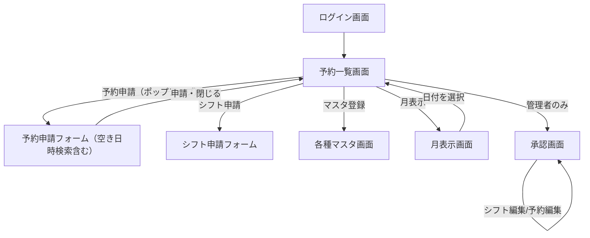

# ヘルプステーション シフト管理・予約管理システム 基本設計書

- 作成日: 2026-09-09
- 前提資料: [要件定義書](./要件定義書.md)（8章48項目中46件解決・2件保留の状態を前提とする）
- ステータス: 一次レビュー反映済み（2026-09-11）

本書は要件定義書で解決済みとなった内容をもとに、画面・データベース・非機能面の設計をまとめたものである。要件定義書8.2（保留・未解決）に残る2件は、本書の該当箇所に「保留」として明記し、確定次第この基本設計書へ反映する。

## 1. システム構成

- クライアント: スマートフォン・タブレットのブラウザ（レスポンシブWebアプリケーション、要件定義書7章参照）
- サーバー: Webアプリケーションサーバー＋データベースサーバーの構成とする
- 通信: HTTPS
- ホスティング環境・冗長構成・バックアップ方式は未確定（要件定義書8.2項目2参照）

## 2. 画面一覧

| # | 画面名 | 対応するロール | 要件定義書 参照 |
|---|---|---|---|
| 1 | ログイン画面 | 全員 | 6.1 |
| 2 | 予約一覧画面（トップ画面） | 全員 | 6.3 |
| 3 | 予約申請フォーム（空き日時検索3パターンを含む。予約一覧画面上のポップアップ） | 職員・管理者 | 6.4.2・6.4.3 |
| 4 | シフト申請フォーム | 職員・管理者 | 6.5.2 |
| 5 | 承認画面（シフト・予約共通） | 管理者のみ | 6.6 |
| 6 | 職員マスタ（一覧／登録・変更・削除、削除は論理削除） | 管理者のみ | 6.8.1 |
| 7 | 利用者マスタ（一覧／登録・変更・削除、削除は論理削除） | 管理者のみ | 6.8.2 |
| 8 | 支援内容マスタ（一覧／登録・変更・削除、削除は論理削除） | 管理者のみ | 6.8.3 |
| 9 | 車両マスタ（一覧／登録・変更・削除、削除は論理削除） | 管理者のみ | 6.8.4 |
| 10 | 月表示画面（予約一覧の月単位表示、閲覧専用） | 全員 | 6.3 |

予約申請フォーム（3）は独立した画面とせず、予約一覧画面（2）の上にポップアップで表示する（8.5参照）。

空き日時検索（3パターン）は独立画面とせず、予約申請フォーム内に検索セクション（タブ等での切替）として組み込み、検索結果を選択するとフォームの日付・時間帯へ自動反映される構成とする。

各マスタ画面（6〜9）には「有効な一覧」と「削除済み一覧」を切り替えるタブ等を設け、削除済み一覧から対象レコードを選んで復元できるようにする（要件定義書8.1項目34参照）。

## 3. 画面遷移

## 4. データベース設計

以下はテーブルの論理設計案である。要件定義書8.1で解決済みとなったDB関連項目（8.1項目13〜16等）を反映している。ER図としての正式化は別途行う。

職員・利用者・支援内容・車両の4マスタは、いずれもシフト・予約等から参照されているため物理削除はせず、論理削除（一覧・選択肢からのみ除外）で統一する（要件定義書8.1項目26参照）。

### 4.1 職員（staff）

| カラム | 型 | 制約 | 備考 |
|---|---|---|---|
| id | INT | PK | |
| login_id | VARCHAR | UNIQUE, NOT NULL | ログイン認証用。半角の英字・数字・`-`・`_`のみ使用できる（職員マスタでの登録時・ログイン時とも同じ決まりでチェックする）。ログイン時は、全角の英数字・空白を半角に直し、前後の空白を取り除いてから照合する |
| password_hash | VARCHAR | NOT NULL | |
| name | VARCHAR | NOT NULL | 氏名 |
| role | ENUM(社員, 管理) | NOT NULL | 3章のロール定義に対応 |
| annual_work_hour_limit | INT | NULL可 | 年間労働時間上限（時間） |
| failed_login_count | INT | NOT NULL | 連続ログイン失敗回数。5回で30分間ロックする（要件定義書8.1項目27参照） |
| last_failed_login_at | DATETIME | NULL可 | 直近のログイン失敗日時。ここから30分経過した失敗はカウントをリセットする |
| locked_until | DATETIME | NULL可 | ロック解除予定時刻。NULLはロックなし |
| deleted_at | DATETIME | NULL可 | 論理削除日時。NULLは有効。削除済みは一覧・選択肢から除外するが、既存シフト・予約からの参照は保持する。削除済み一覧からの復元操作でNULLに戻す |
| created_at | DATETIME | NOT NULL | |
| updated_at | DATETIME | NOT NULL | |

### 4.2 職員デフォルト勤務時間（staff_default_schedule）

曜日ごとに1レコード（職員1人につき7レコード）。

| カラム | 型 | 制約 | 備考 |
|---|---|---|---|
| id | INT | PK | |
| staff_id | INT | FK → staff.id, NOT NULL | |
| day_of_week | TINYINT | 0〜6, NOT NULL | 日〜土 |
| is_am_off | BOOLEAN | NOT NULL | 午前休み（am_off・pm_off両方trueで終日休み） |
| is_pm_off | BOOLEAN | NOT NULL | 午後休み（am_off・pm_off両方trueで終日休み） |
| start_time | TIME | NULL可 | 始業時刻 |
| end_time | TIME | NULL可 | 終業時刻 |

### 4.3 利用者（client）

| カラム | 型 | 制約 | 備考 |
|---|---|---|---|
| id | INT | PK | |
| last_name | VARCHAR | NOT NULL | 苗字のみ（不正アクセス対策） |
| last_name_kana | VARCHAR | NOT NULL | 苗字の読み仮名（ひらがな）。予約申請フォームでの絞り込みと、50音順の並び替えに使用する（要件定義書8.1項目47参照） |
| wheelchair_required | BOOLEAN | NOT NULL | 車いすの要否（電動／手動の区別は初回リリースでは行わない、要件定義書9章参照） |
| interval_unit | ENUM(日, 週, 月) | NULL可 | 利用間隔の単位。固定設定がない利用者向けの予約忘れ検出に使用（要件定義書8.1項目4参照） |
| interval_value | INT | NULL可 | 利用間隔の数値。「3」＋「月」で「3か月後」のように、前回予約日からの経過期間を表す |
| fixed_start_date | DATE | NULL可 | 固定（定期訪問）の開始日。終了日は持たず、開始日以降ずっと有効とする（要件定義書8.1項目21参照） |
| deleted_at | DATETIME | NULL可 | 論理削除日時。NULLは有効。削除済みは一覧・選択肢から除外するが、既存シフト・予約からの参照は保持する。削除済み一覧からの復元操作でNULLに戻す |

デフォルト担当者・固定訪問の曜日はいずれも複数選択可のため、以下の中間テーブルで管理する。固定訪問の時刻は曜日ごとに異なりうるため、client_fixed_day_of_week側で保持する。

**利用者デフォルト担当者（client_default_staff）**

複合主キー：(client_id, staff_id)。

| カラム | 型 | 制約 | 備考 |
|---|---|---|---|
| client_id | INT | FK → client.id, NOT NULL | |
| staff_id | INT | FK → staff.id, NOT NULL | 複数登録可。予約申請フォームの担当者初期値として使用 |

**利用者固定訪問曜日（client_fixed_day_of_week）**

複合主キー：(client_id, day_of_week)。

| カラム | 型 | 制約 | 備考 |
|---|---|---|---|
| client_id | INT | FK → client.id, NOT NULL | |
| day_of_week | TINYINT | 0〜6, NOT NULL | 複数登録可。日〜土 |
| fixed_start_time | TIME | NOT NULL | 固定訪問の時刻（開始）。曜日ごとに設定 |
| fixed_end_time | TIME | NOT NULL | 固定訪問の時刻（終了）。曜日ごとに設定 |

### 4.4 支援内容（support_type）

| カラム | 型 | 制約 | 備考 |
|---|---|---|---|
| id | INT | PK | |
| name | VARCHAR | NOT NULL | 通院（病院）等 |
| dispatch_priority | INT | NOT NULL | 配車優先度。管理者が任意に設定・変更可能（要件定義書8.1項目12参照） |
| deleted_at | DATETIME | NULL可 | 論理削除日時。NULLは有効。削除済みは一覧・選択肢から除外するが、既存予約からの参照は保持する。削除済み一覧からの復元操作でNULLに戻す |

### 4.5 車両（vehicle）

| カラム | 型 | 制約 | 備考 |
|---|---|---|---|
| id | INT | PK | |
| name | VARCHAR | NOT NULL | 例：福祉車両1 |
| type | ENUM(福祉車両_電動, 福祉車両_手動, 普通社用車) | NOT NULL | 私用車はレコードを持たない（要件定義書8.1項目7参照）。電動／手動の区別は初回リリースでは業務上行わず、福祉車両は実態によらずすべて「福祉車両_電動」として登録する（要件定義書9章参照） |
| is_unavailable | BOOLEAN | NOT NULL | 使用不可フラグ。点検・故障等で一時的に使用できない状態を示す。trueの間は空き判定の合算台数から除外する（要件定義書8.1項目28参照） |
| deleted_at | DATETIME | NULL可 | 論理削除日時。NULLは有効。削除済みは一覧・選択肢から除外するが、既存シフト・予約からの参照は保持する。削除済み一覧からの復元操作でNULLに戻す |

### 4.6 シフト（shift）／シフト詳細（shift_detail）

shift は職員×対象月で1レコード、shift_detail は日ごとに1レコード。

**shift**

一意制約：(staff_id, target_year_month)の組み合わせは重複しない（職員×対象月で1レコード）。

| カラム | 型 | 制約 | 備考 |
|---|---|---|---|
| id | INT | PK | |
| staff_id | INT | FK → staff.id, NOT NULL | |
| target_year_month | CHAR(7) | NOT NULL | 例：2026-10 |
| submitted_at | DATETIME | NULL可 | 申請日時 |

**shift_detail**

一意制約：(shift_id, date)の組み合わせは重複しない（日ごとに1レコード）。

| カラム | 型 | 制約 | 備考 |
|---|---|---|---|
| id | INT | PK | |
| shift_id | INT | FK → shift.id, NOT NULL | |
| date | DATE | NOT NULL | |
| applied_start_time | TIME | NULL可 | 社員が申請した始業時刻 |
| applied_end_time | TIME | NULL可 | 社員が申請した終業時刻 |
| applied_am_off | BOOLEAN | NOT NULL | 休みの設定（午前休。終日休みはam_off・pm_off両方true） |
| applied_pm_off | BOOLEAN | NOT NULL | 休みの設定（午後休。終日休みはam_off・pm_off両方true） |
| applied_desired_off | BOOLEAN | NOT NULL | 希望休フラグ。休み自体の設定は上記am_off／pm_offで行い、本フラグはその休みが職員本人の希望によるものであることを示す |
| approval_flag | BOOLEAN | NOT NULL | 承認フラグ |
| admin_modified_flag | BOOLEAN | NOT NULL | 管理者が変更したか |
| modified_start_time | TIME | NULL可 | 管理者変更後の始業時刻 |
| modified_end_time | TIME | NULL可 | 管理者変更後の終業時刻 |
| modified_am_off | BOOLEAN | NOT NULL | 管理者変更後の午前休 |
| modified_pm_off | BOOLEAN | NOT NULL | 管理者変更後の午後休 |
| modified_approval_flag | BOOLEAN | NOT NULL | 管理者変更後の承認フラグ |

申請内容と管理者変更内容を別カラムで保持する設計とし、職員が申請した内容自体は保持されたまま、管理者による変更は別データとして記録する。画面上は、管理者変更があれば変更後の内容（確定内容）を表示し、変更があった旨を示す表示を行う。あわせて元の申請内容も参照できるようにする（要件定義書8.1項目11参照）。

### 4.7 予約（reservation）

| カラム | 型 | 制約 | 備考 |
|---|---|---|---|
| id | INT | PK | |
| client_id | INT | FK → client.id, NOT NULL | |
| date | DATE | NOT NULL | |
| start_time | TIME | NOT NULL | 「開始時刻＋終了時刻」方式（要件定義書8.1項目10参照） |
| end_time | TIME | NULL可 | 「開始時刻＋終了時刻」方式（要件定義書8.1項目10参照）。NULLは終了未定の予約（病院の診療等）。NULLの場合の扱い（みなし終了時刻・重複チェック対象外）は要件定義書6.4.4・8.1項目45参照 |
| support_type_id | INT | FK → support_type.id, NOT NULL | |
| vehicle_id | INT | FK → vehicle.id, NULL可 | 福祉車両／普通社用車を選択し空きがある場合、配車優先度を参考にシステムが自動的に具体的な1台を決定し即時に設定する。福祉車両・普通社用車は別々の車両プールとして空き判定・優先度判定を行う（要件定義書8.1項目30参照）。後から優先度の高い予約が登録された際、既存予約のvehicle_idがシステムにより自動的に別の車両IDへ更新される場合がある（vehicle_reassigned_flag参照、要件定義書8.1項目31参照）。車不要・私用車の場合は常にNULL（要件定義書6.4.4参照） |
| vehicle_type_choice | ENUM(福祉車両, 普通社用車, 私用車, 車不要) | NOT NULL | フォーム上の選択内容。私用車は車両マスタに存在しないため別カラムで保持 |
| remarks | TEXT | NULL可 | 備考（要件定義書8.1項目14参照） |
| status | ENUM(仮登録, 承認済み) | NOT NULL | 仮登録／承認済みの状態管理用（要件定義書8.1項目15参照）。職員が登録した予約は仮登録、管理者が登録した予約は承認済みで登録する（要件定義書8.1項目41参照） |
| vehicle_reassigned_flag | BOOLEAN | NOT NULL | 配車優先度判定によりシステムが自動的に車両を再割当したことを示す。予約一覧画面・承認画面での表示に使用する（要件定義書8.1項目31参照） |
| created_at | DATETIME | NOT NULL | |
| updated_at | DATETIME | NOT NULL | |

### 4.8 予約担当者（reservation_staff）

予約と職員の中間テーブル（多対多）。要件定義書8.1項目13参照（最重要事項）。一意制約：(reservation_id, staff_id)の組み合わせは重複しない（担当者未決定を表すstaff_id NULLの行は予約1件につき1行のみ登録する）。

| カラム | 型 | 制約 | 備考 |
|---|---|---|---|
| reservation_id | INT | FK → reservation.id, NOT NULL | |
| staff_id | INT | FK → staff.id, NULL可 | NULLの場合は「担当者未決定の予約」として承認画面に表示 |

### 4.9 監査ログ

DBテーブルとしては持たず、サーバ上のテキストファイルに出力する（アプリ内の閲覧画面は設けない、要件定義書8.1項目29参照）。1行1操作のログとして、以下の項目を出力する。保存期間はシフト・予約と同様に当年+3年分とする（要件定義書8.1項目32参照）。

| 項目 | 備考 |
|---|---|
| 日時 | |
| 職員ID | ログイン失敗時等はNULLの場合あり |
| 操作種別 | login/create/update/delete/approve 等 |
| 対象テーブル名 | |
| 対象レコードID | |
| 変更内容・登録内容・削除内容 | 削除時は削除されたレコードの内容を記録する（要件定義書8.1項目33参照） |
| IPアドレス | ログイン試行時のみ |

## 5. 機能仕様概要

各機能の詳細な業務ルールは要件定義書6章を正とし、本章では設計上のポイントのみ記載する。

- **配車優先度・車両空き判定**（要件定義書6.4.4参照）：福祉車両は「福祉車両_電動」「福祉車両_手動」を区別せず、福祉車両全体の台数で空き判定を行う（初回リリースでは全車両を「福祉車両_電動」として登録するため、実質的に区別は発生しない。要件定義書9章参照）。普通社用車も同様に台数（3台）で空き判定を行う。**福祉車両と普通社用車は別々の車両プールとして扱い、空き判定・優先度判定・再割当は車両種別ごとに独立して行う**（要件定義書8.1項目30参照）。配車優先度による車両の再割当（既存予約からの車両外し・付け替え）もシステムが自動で行うが、予約自体の日時・担当者調整は担当者が手動で行う。再割当された予約は担当者へアラート通知するとともに、vehicle_reassigned_flagにより予約一覧画面・承認画面でも表示する（要件定義書8.1項目31参照）。
- **シフト申請締切**（要件定義書8.1項目23参照）：自動仮登録・申請ロックは行わない。シフト申請フォームは対象月を選択でき、未申請の過去月にも常にアクセスできる。締切日は「シフト未申請アラート」「シフト未承認アラート」の通知タイミングを決めるためだけに使用する。
- **私用車の扱い**（要件定義書8.1項目7参照）：車両マスタには登録せず、reservation.vehicle_type_choice で管理する。
- **予約忘れ検知**（要件定義書8.1項目4参照）：固定（定期訪問）設定がある利用者は固定の曜日設定を検知に流用し、設定がない利用者は前回予約日から利用間隔（数値＋単位）で指定した期間経過後、新たな予約がなければ検知対象とする。

## 6. 非機能設計

要件定義書7章の非機能要件のうち、設計判断が必要な項目を記載する。未確定の項目は要件定義書8.2を参照。

| 項目 | 設計方針 |
|---|---|
| データ保持期間 | シフト・予約とも当年+3年分を保持。シフト・予約は職員・利用者・車両・支援内容マスタを参照しているため、マスタを物理削除すると3年分の履歴を正しく参照できなくなる。この矛盾を避けるため、4種のマスタすべて削除操作は論理削除で統一し、既存レコードからの参照を保持する（要件定義書8.1項目26参照）。監査ログも同様に当年+3年分を保持する（要件定義書8.1項目32参照） |
| バックアップ・可用性 | 未確定（要件定義書8.2項目2参照） |
| オフライン対応 | 今回のスコープ外（将来検討）。方式案：直近取得データのローカルキャッシュによる閲覧、フォーム入力の下書き自動保存（要件定義書8.1項目24参照） |
| 認証セキュリティ | 要件定義書7章の記載のとおり（要件定義書8.1項目27参照）。実装方針の詳細は技術仕様書6章参照 |

## 7. 保留事項の引き継ぎ

要件定義書8.2に残る2件は、確定次第本書に反映する。

## 8. 予約一覧画面 詳細設計

要件定義書6.3の機能要件を実現する画面レイアウトを、デバイス種別ごとに以下のとおり定める（モックアップ：[予約一覧画面モックアップ](https://claude.ai/artifact/EHxFpwczYFZrPt2fd4oYmC)）。

### 8.1 共通方針

- 予約は、一覧内で見出し行やグリッドのセルとしてではなく、カードとして表示する（要件定義書6.3「シフト申請と予約申請は...明確に区別する」に対応）。
- 予約カードは、同じ日・同じ利用者の予約を1枚にまとめる（要件定義書6.3・8.1項目39参照）。
  - まとめる単位は利用者IDとする（同じ苗字の別の利用者はまとめない）。
  - カード内では予約ごとに1つのまとまりで表示し、開始時刻順に並べる。予約と予約の間は横線で区切る。
  - 1件の予約は、紙の予定表に合わせて、左の列（人）と右の列（内容）の2列で表示する。左の列の幅は全予約でそろえる。
    - 1行目：左に利用者名（カード内の最初の予約のみ。2件目以降は空ける。蛍光ペンで線を引いたように、文字の下半分に色を付けて目立たせる）、右に支援内容と私用車の「●」。右端に操作ボタン（下記）を置き、備考の長さにかかわらず常に1行目の右端に表示する。
    - 2行目：右に備考（備考がある場合のみ。小さめの薄い文字で2行まで表示し、超える分は省略する。全文はマウスを乗せると表示する）。
    - 3行目：右に時刻・車両の札・配車変更の印。終了時刻が空欄の予約（終了未定）は、開始時刻のみを「9:00〜」のように表示する（要件定義書8.1項目45参照）。
    - 担当者は、左の列の2行目〜3行目に、時刻の行から上に向かって並べる（1行に2人まで。3人以上は備考の行の横まで使う）。担当者未定は「未定」と注意の印（三角の印）を表示し、2人分の幅を使う。
  - 支援内容・担当者・シフトの職員名など、幅に収まらず省略して表示する文字は、省略されている場合のみ、マウスを乗せると全文を表示する。
  - 車両は、種類を1文字の札で表示する（福祉車両は「福」、普通社用車は「普」）。種類ごとに札の色を変え、具体的な車両名はマウスを乗せると表示する。私用車は札を出さず「●」で表示し、車不要は何も表示しない。
  - ポップアップで開いている予約は、背景色を変えて、どの予約を開いているかわかるようにする。
  - 「仮登録」「配車変更」の表示は行ごとに行う。カード内に仮登録の予約が1件でもある場合は、カード全体も仮登録の見た目（枠・背景色）にする。
  - カードの並び順は、カード内で最も早い開始時刻の順とする。
  - 絞り込みは予約単位で先に行い、条件に合った予約だけをカードにまとめる（条件に合わない行はカードに表示しない）。
- 予約カードの各行に、以下の操作ボタンを表示する（要件定義書6.3・8.1項目43参照）。
  - 変更（管理者のみ）：予約申請ポップアップ（8.5参照）を変更の状態で開く。
  - 承認（管理者のみ、仮登録の行のみ）：確認メッセージを表示したうえで、その予約を承認済みにする。承認ボタンは仮登録の表示を兼ね、仮登録の行には全員に表示するが、押せるのは管理者のみとする。
  - 閲覧（管理者以外）：予約申請ポップアップを閲覧のみの状態で開く。
- 予約カードの各行に備考を表示する。カード上では2行程度で切り詰め、全文は変更・閲覧のポップアップで確認する。
- 私用車の予約は、車両名の代わりに「●」を表示する（紙の予定表の「●＝私有車使用」に合わせる）。画面上に「●＝私用車」の凡例を表示する。
  - シフトはカードとして表示せず、カード外の情報欄に表示する（下記参照）。
- シフト（誰が何時から何時まで勤務するか）・休みは、個別の予約と同列のカードとしては扱わず、各日の情報欄（日付見出しの直下、予約カード一覧の上）にテキストで表示する。これにより、予約カードの一覧とシフト・休みの状況を視覚的に区別する。その日に勤務する職員・休みの職員を先に確認してから予約を見られるよう、予約カードより上に置く。
- 画面上部の機能ボタン（絞り込み・週の操作・日付指定・新規追加）と日付見出しは、画面上部に固定表示する。シフト・休みの情報欄は固定せず、予約カードと一緒にスクロールする（勤務する職員が多い日に情報欄が高くなり、予約カードの見える範囲が狭くなるため）。スクロール中も、どの列が何日かを確認できるようにする。予約申請ポップアップ（8.5参照）は、固定表示した部分より手前に表示する。
- 画面上に「新規追加」ボタンを設置する。タップすると予約申請フォーム（6.4）・シフト申請フォーム（6.5）への入口となる（新規追加するのが予約かシフトかを選択させる形を想定）。予約申請フォームは画面遷移せず、ポップアップで表示する（8.5参照）。
- 個人画面は設けない。自分の予定は、絞り込みの「自分自身」で確認する（要件定義書6.3・8.1項目38参照）。
- 情報欄のシフトの行には、その職員のその日の担当予約（開始時刻順）のうち、最初の予約が私用車であれば行の先頭に（直行）、最後の予約が私用車であれば行の末尾に（直帰）「●」を表示する。予約の絞り込み中も、絞り込む前のすべての予約で判定する。
- 情報欄では、管理者による変更があったシフトに印を付け、印をタッチ（クリック）すると元の申請内容を表示する（要件定義書6.3・8.1項目11参照）。
- 情報欄のシフトの行は、名前・開始時刻・終了時刻・印（午前休「AM」、午後休「PM」、直帰の「●」、管理者変更の印）の列をそろえて表示する。開始時刻は右寄せにして「〜」の位置をそろえ、直行の「●」は開始時刻のすぐ左に付ける。終日休みの職員は、シフトの行ではなく「休：」の行に名前を並べる（入りきらない名前は「休：」の右側で折り返す）。
  - 希望休（要件定義書6.5.2参照）の職員は、「休：」の行とは別の「希望休：」の行に名前を並べる。終日の希望休の職員は「希望休：」の行にのみ表示する。午前のみ・午後のみの希望休の職員は、勤務する時間があるため、シフトの行（勤務時間と「AM」「PM」の印）と「希望休：」の行（名前と「AM」「PM」の印）の両方に表示する。
  - 「休：」「希望休：」の行では、名前と名前の間に区切りの記号は付けず、間隔を空けて並べる。1人分の名前と印は、折り返しで離れないようにまとめて表示する。
  - その日に勤務・休み・希望休のいずれもない場合は、情報欄自体を表示しない。
- 日付見出しは、日曜を赤、土曜を青の文字にし、今日の日付は背景色を付けて目立たせる。年は、週の最初の日と年が変わる日のみ表示する（月表示では、最初の週の最初の日と年が変わる日のみ）。
- 画面上部の機能ボタンは、広い画面では1行にまとめ、左に絞り込み、中央に週の操作、右に月表示への切替・新規追加・ログイン中の職員名・ログアウトボタンを置く。狭い画面では折り返して表示する。
  - ログアウトボタンは、新規の予約の入力途中の内容がある場合、確認メッセージを表示してからログアウトする（ログアウトすると入力内容は消えるため）。月表示画面にも、同じ位置にログイン中の職員名・ログアウトボタンを置く。
- 各日の予約カードは、カード内で最も早い開始時刻の順に並べる。ソート機能は設けない（要件定義書6.3・8.1項目36参照）。
- 画面上部に週の操作ボタン（前週・今週・次週）を配置し、「今週」ボタンの横に日付指定ボタンを設ける。日付指定ボタンで日付を選ぶと、その日を含む週へ移動する。表示中の週はURLのクエリパラメータで保持する（技術仕様書7章参照）。
  - PCでは、キーボードの ← → でも前週・次週に移動できる（日付の入力欄・プルダウンの操作中は除く）。
  - 日付指定で入力できる日付は、2023-01-01以降とする（固定の日付。年が変わっても自動ではずらさない）。業務上の上限は設けないが、年を4桁で入力できるように、入力欄の上限は9999-12-31とする（技術仕様書5.5参照）。予約申請ポップアップの予約日の欄も、同じ範囲とする。範囲外の日付が入力された場合は移動しない。URLのクエリパラメータで直接指定された場合も、サーバー側で同じ範囲をチェックする。
  - キーボードで日付を入力している途中（例：「21日」の「2」を入力した時点）では移動せず、Enterキーを押したとき、または入力欄からフォーカスが外れたときに移動する。カレンダーから日付を選んだ場合は、すぐに移動する。
- 絞り込み（フィルター）は、条件の種類（全体／自分自身／職員／車両／利用者）を選ぶプルダウンと、職員・車両・利用者を選んだ場合に対象の1件を選ぶプルダウンで構成する（要件定義書6.3・8.1項目37参照）。
  - 「自分自身」はログイン中の職員を対象とする。
  - 車両の選択肢は、論理削除されていないマスタレコードのみとする。
  - 職員の選択肢は、表示中の週に勤務日（終日休みを除く）がある職員、または表示中の週の予約の担当者になっている職員のみとする（シフトに入る頻度が低い職員が多いため）。勤務日があって予約が0件の職員は、予約を入れられる職員として確認できる。選択中の職員は、週を切り替えて該当しなくなった場合も選択肢に残し、予約0件として表示する。
  - 「自分自身」は、表示中の週の勤務日の有無にかかわらず選択できる。
  - 利用者の選択肢は、表示中の週に予約がある利用者のみとする（全利用者を表示すると選択肢が多くなりすぎるため）。選択中の利用者は、週を切り替えて予約がなくなった場合も選択肢に残し、予約0件として表示する。
  - 同じ苗字の利用者が選択肢に複数ある場合のみ、苗字の後ろに利用者IDを付けて表示する（例：鈴木（3））。1人だけの場合は苗字のみとする。
  - 絞り込みは予約カードにのみ適用し、シフト・休みの情報欄は絞り込まない（配車・担当の判断材料として全員分を表示するため）。
  - 週を切り替えても絞り込み条件を保持する。

### 8.2 スマートフォン版

- 画面上部に日付タブ（日〜土）を横スクロールで配置し、タップした日の予約カードを一覧表示する（要件定義書6.3「全体の予定画面：週単位で表示」に対応。週の7日分をタブとして持ち、1日分ずつカードリストを切り替える）。
- 日付タブの直下（カード一覧の上）に、その日のシフト・休みの情報欄を表示する（8.1参照）。

### 8.3 PC版

- PC版では週単位のグリッドで表示する（日〜土の7列。タブによる1日ずつの切替は行わない）。
- 各列は、日付見出し→その日のシフト・休みの情報欄（8.1参照、カードではなくテキスト）→予約カードの一覧、の順に縦に並べる。

### 8.4 今後の検討事項

- 新規追加ボタンをタップした際、予約・シフトのどちらを追加するか選択させるUI（メニュー表示かボタン2つに分けるか等）は未確定。実装時に確定する。
- 月表示画面（8.6）の週ブロックの下のシフト欄に表示する職員の範囲（全職員か、その週に勤務日がある職員のみか）は、実際の職員数で表示を確認して確定する。
- 月表示画面（8.6）を印刷して紙の予定表の代わりに使うか（印刷時の用紙サイズ・1週ごとの改ページ等）は、月表示画面の確認後に検討する。

### 8.5 予約申請ポップアップ

予約申請フォーム（要件定義書6.4.3）は、予約一覧画面の上にポップアップで表示する（要件定義書8.1項目40参照）。

- PC版
  - 後ろの予約一覧画面を操作できる形（非モーダル）で表示する。ポップアップを開いたまま、予約一覧のスクロール・週の切替・絞り込みができる。
  - ポップアップのタイトル部分をドラッグして、表示位置を移動できる。ドラッグ中も、ポップアップは画面の外に出ないようにする。
  - ポップアップを開いたときの表示位置は、押したボタンを基準に決める。
    - 新規の予約（新規追加ボタン）：ボタンの真下に表示する。
    - 既存の予約の変更・閲覧（予約カードの変更ボタン・閲覧ボタン）：ボタンの右側に表示する。右側に収まらない場合は、左側に表示する。
    - いずれの場合も、画面からはみ出す場合は、画面内に収まる位置にずらして表示する。
  - ポップアップを新規・変更の状態で開いている間は、予約一覧画面のシフト・休みの情報欄（8.1参照）のシフトの行を押して、入力欄に反映できる。
    - 押したシフトの日付を「予約日」に入れ、その職員を「担当者」に追加する。同じ職員のシフトをもう一度押すと、担当者から外す（予約日はそのまま）。
    - 続けて同じ日の別の職員のシフトを押すと、担当者を複数入れられる。新規の場合は、別の日のシフトを押すと、予約日がその日に変わり、担当者は押した職員だけになる（前の日の担当者は外す。別の日に勤務しない職員が担当者に残らないようにするため）。
    - 変更の場合は、ポップアップの予約日の日のシフトだけを押せる（担当者の追加・解除のみで、シフトを押して予約日を変えることはできない）。予約日を変えるときは、ポップアップの予約日の欄か、日付の見出し（下記）で変更する。
    - 押せるのは勤務がある職員のシフトの行のみとし、休みの職員の名前は押せない。
  - ポップアップを新規・変更の状態で開いている間は、日付の見出しを押して、その日を「予約日」に入れられる（担当者は変えない）。押せる間だけ、押せることがわかる見た目（カーソル・背景色の変化）にする。
    - 閲覧の状態のとき、ポップアップを閉じているとき、月表示画面（8.6）では押せない。押せる間だけ、シフトの行が押せることがわかる見た目（カーソル・背景色の変化）にする。
  - ポップアップの予約日の欄で、表示中の週以外の日付を選ぶと、予約一覧をその日を含む週へ移動する（ポップアップと入力内容はそのまま）。直接入力の場合は、入力途中で移動しないよう、入力を確定したとき（入力欄を離れたとき）に移動する。
  - ポップアップを新規・変更の状態で開いている間は、入力中の内容に合わせて、予約一覧の次の部分を目立たせる（背景色を変える）。
    - 予約日：その日の日付見出し。
    - 予約日と開始時刻：その日の予約のうち、入力中の時間と重なる予約（変更中の予約自身は除く）。終了時刻が空欄の場合は、開始時刻だけで判定する（開始時刻が同じ予約、または開始時刻を含む予約）。
    - 予約日と開始時刻：その日のシフトのうち、入力中の時間に対応できる職員のシフト。入力中の時間が、その職員の勤務時間（午前休は13:30から、午後休は12:30までとして扱う）に収まり、かつその時間に担当している予約がない（変更中の予約自身は除く）場合に、対応できると判定する。予約の絞り込み中も、絞り込む前のすべての予約で判定する。
- スマートフォン版
  - 画面全体（または画面下部からせり上がる形）で表示し、移動はできない。予約一覧を確認する場合は、一度閉じて確認する。
- 入力欄の並びと操作（PC・スマートフォン共通）
  - 各入力欄は、左に項目名、右に入力欄を並べ、入力欄の左端を縦にそろえる。入力エラーのメッセージは、該当する入力欄の下に、入力欄の左端にそろえて表示する。
  - 利用者は、入力欄に文字を入力すると、読み仮名または苗字にその文字を含む利用者だけを候補として表示し、候補から選ぶ（要件定義書8.1項目47参照）。
    - 候補は読み仮名の50音順に並べる。何も入力していないときは、全員を50音順に表示する。
    - カタカナで入力した場合も、ひらがなと同じものとして絞り込む。
    - 候補の一覧は、入力欄に入ったとき・文字を入力したとき・下矢印キーを押したときに開く。候補が1件以上ある場合は、先頭の候補を選んでいる状態にする。
    - 候補は、マウスで選ぶか、上下の矢印キーで切り替えてEnterキーで選ぶ。Enterキーで選んだ場合は、続けて次の入力欄へ移る。選んだ後は、入力欄に利用者の苗字を表示する。
    - 利用者が決まっていない状態でEnterキーを押しても、次の入力欄へは移らない（入力した文字が消えないようにするため）。日本語の変換中のEnterキーは、変換の確定のみとする。
    - 候補の一覧を開いている間にEscキーを押すと、一覧を閉じ、入力欄と選んだ利用者を消去する（ポップアップは閉じない）。一覧を閉じているときのEscキーは、ポップアップを閉じる。
    - 候補から選ばずに入力欄を離れた場合は、利用者を未選択とする（入力した文字だけでは登録しない）。
    - ブラウザの入力履歴は表示しない。
  - 担当者は、プルダウンで1人ずつ追加し、追加した担当者はプルダウンの上に札で表示する。札の「×」で外せる。追加済みの担当者はプルダウンの選択肢に表示しない。
    - マウスでプルダウンから選んだ場合は、すぐに追加する。キーボード（矢印キー・文字キー等）で選択肢を切り替えた場合は、Enterキーを押したときに追加する（切り替えただけでは追加しない）。追加後はプルダウンにとどまり、続けて追加できる。何も選んでいない状態でEnterキーを押すと、次の入力欄へ移る。
  - Enterキーを押すと、次の入力欄へ移る（Tabキーと同様）。ただし、日本語の変換中、備考欄（改行に使う）、ボタン上では移らない。車両の選択肢は1つの項目として扱い、選択中の選択肢に止まる。担当者の札の「×」には止まらない。
  - Escキーでポップアップを閉じる（日本語の変換中は除く）。変更の状態で変更がある場合は、閉じる前に確認メッセージを表示する。
- 入力内容の保持（PC・スマートフォン共通）
  - 新規の予約の入力内容は、ポップアップを閉じても、ページを開いている間（週の切替・絞り込みを含む）は保持する。再読み込みやブラウザを閉じた場合は保持しない。
  - 「入力をクリア」ボタンで入力内容を消去できる（確認メッセージを表示する）。申請に成功した場合は、入力内容を消去してポップアップを閉じる。
  - 入力途中の内容がある場合は、「新規追加」ボタンに「入力中」等の表示を付ける。
- 既存の予約の変更（管理者のみ）
  - 予約カードの変更ボタン（8.1参照）から、同じポップアップを変更の状態で開く。
  - 日付・時刻・担当者・支援内容・車両・備考を変更できる。利用者は変更できない（要件定義書8.1項目44参照）。
  - 管理者が仮登録の予約を変更した場合は、承認済みとする。
  - 車両の種類を変更した場合は、割り当て済みの車両（vehicle_id）を解除し、配車変更の表示（vehicle_reassigned_flag）も解除する。配車処理（VehicleAssignmentService、技術仕様書5.1参照）の実装後は、変更後の種類で車両を割り当て直す。
  - 編集内容は保持せず、ポップアップを閉じると破棄する。変更がある場合は、閉じる前に確認メッセージを表示する。
  - ポップアップの下部に「削除」ボタンを表示する（変更の状態のときのみ）。確認メッセージを表示してから予約を物理削除し、予約担当者（reservation_staff）の行もあわせて削除する。削除内容は監査ログに記録する（要件定義書8.1項目46参照）。
- 既存の予約の閲覧（管理者以外）
  - 予約カードの閲覧ボタン（8.1参照）から、同じポップアップを閲覧のみの状態で開く。
  - すべての入力欄を入力できない状態にし、「申請」「入力をクリア」ボタンは表示しない（「閉じる」のみ）。

### 8.6 月表示画面

予約一覧画面（週表示）とは別の画面として、1か月分の予約を表示する（要件定義書6.3・8.1項目42参照）。閲覧専用とし、予約の申請・編集は週表示で行う。レイアウトは、現在紙で運用している「予定表」に合わせる（要件定義書10章「シフト表サンプル」参照）。

- 共通
  - 画面上部に、前月・翌月への移動ボタンと、週表示へ戻るボタンを配置する。表示中の月はURLのクエリパラメータで保持する（技術仕様書7章参照）。
  - 月の指定欄で入力できる範囲・移動するタイミングは、週表示の日付指定（8.1参照）と同じとする（2023年1月以降、9999年12月まで）。
  - 1週間（日〜土の7列）を1つの週ブロックとし、表示する月にかかる週ブロックを縦に並べる（月によって4〜6週）。前月・翌月の日は、背景を灰色にするなどして区別する。
  - 各日の予約は、開始時刻順に「利用者（苗字）・担当者」と「支援内容・時刻」を並べて表示する。私用車を使う予約（`vehicle_type_choice = 'private_car'`）には印（●）を付け、画面上部に「● ＝私用車使用」の凡例を表示する。
  - 仮登録の予約は、週表示と同様に区別できるようにする。
  - 各週ブロックの各日に、シフト・休みの情報欄を設け、職員ごとのシフト（勤務時間、休み、希望休、午前休・午後休）を表示する。週表示（8.1〜8.3）と同じく、情報欄は予約の上（日付見出しの直下）に置く（週表示と同じ部品で表示し、見た目をそろえるため）。表示する職員の範囲は8.4参照。
- PC版
  - 各日のすべての予約を表示する（件数を絞って「他n件」とまとめることはしない）。予約の多い日に合わせて、週ブロックの高さが伸びる。
  - 日付をクリックすると、その日を含む週の週表示（予約一覧画面）へ移動する。
  - 画面上部の機能ボタンを画面上部に固定表示する。各週ブロックの日付見出しは、その週ブロックを表示している間、機能ボタンの下に固定表示する（週ブロック全体は固定しない）。
- スマートフォン版
  - 7列を並べられないため、週ごとに見出しを付け、その週の日付を縦に並べる。各日は、その日のシフトの下に、その日の予約一覧を表示する（PC版と同じ順）。

### 8.7 デザインの決まり（画面共通）

画面全体の見た目をそろえ、あとから変更しやすくするための決まり。色・共通の形の実際の値は `resources/css/app.css` で管理し、この節では意味と使い分けを定める。

- 雰囲気：やさしく温かみのある見た目とする（暖色を中心に、角を丸め、影は薄くする）。
- 書体：BIZ UDPゴシック（読み間違いが起きにくいユニバーサルデザイン書体）を使う。読み込めない端末では、端末の日本語書体で表示する。
  - 画面を開くと同時に表示されるプルダウンは、書体の読み込みが終わったあとに作り直し、文字の位置がずれないようにする。
- 色：画面では色を直接指定せず、意味ごとの名前（`app.css` の `@theme`）で指定する。色を変えるときは `app.css` だけを変更する。
  - 画面全体：背景（`base`）、カード・ヘッダーの背景（`surface`）、本文（`ink`）、補足の文字（`ink-muted`）、区切り線（`line`）
  - 予約（メインの色）：`reservation`（濃）・`reservation-medium`（中）・`reservation-soft`（薄）
  - シフト：`shift`・`shift-soft`
  - 状態：仮登録（`provisional`）、配車変更（`reassigned`）、休み（`rest`）、福祉車両（`care-vehicle`）、普通社用車（`company-car`）
  - 操作：削除（`danger`）、控えめなボタン（`neutral`）
  - 日付：日曜（`sunday`）、土曜（`saturday`）
  - 薄い色（`-soft`）を背景に、濃い色を文字に使う組み合わせを基本とする。
- 文字と背景の明るさの差（コントラスト比）は4.5以上とする（読みやすさの基準 WCAG AA）。明るい色の上には白ではなく濃い文字を使う。
- 色だけに頼らず、線の位置・形や文字でも区別できるようにする（色の見分けが苦手な人への配慮）。
  - 予約カード：左に太い線（予約の色）
  - 仮登録の予約を含むカード：点線の枠と薄い背景（仮登録の色）
  - シフト・休みの情報欄：上に太い線（シフトの色）
- ボタンの種類
  - 主な操作（申請・新規追加）：塗りつぶし（予約の色）
  - 控えめな操作（クリア・週や月の移動）：塗りつぶし（控えめな色）
  - 画面の切り替え（週表示・月表示）、危ない操作（削除）：枠線だけ（削除は赤の枠と文字）
  - アイコンだけのボタンには、読み上げ用の名前（`aria-label` または `title`）を付ける。
- 共通の形（`app.css` の `@utility`）：3か所以上で使う形だけをまとめる。
  - `btn`（ボタン）、`btn-outline`（枠線だけのボタン）、`field`（入力欄）、`badge`（札・バッジ）、`form-row`（入力フォームの1行）、`form-danger`（入力エラーのメッセージ）
- 文字の大きさは12px（`text-xs`）を下限とする。
